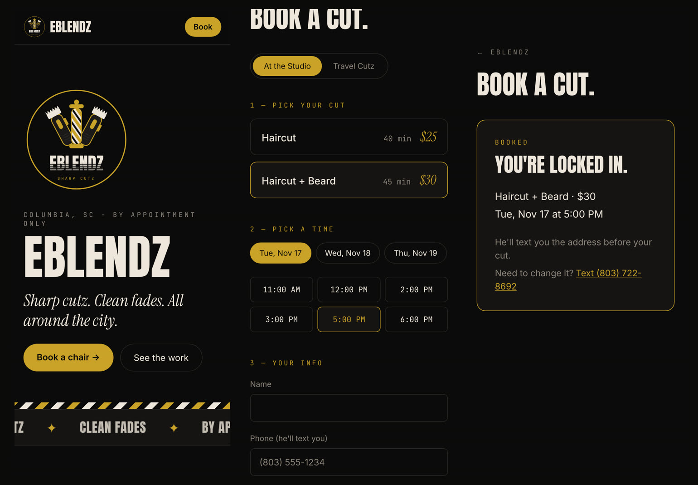
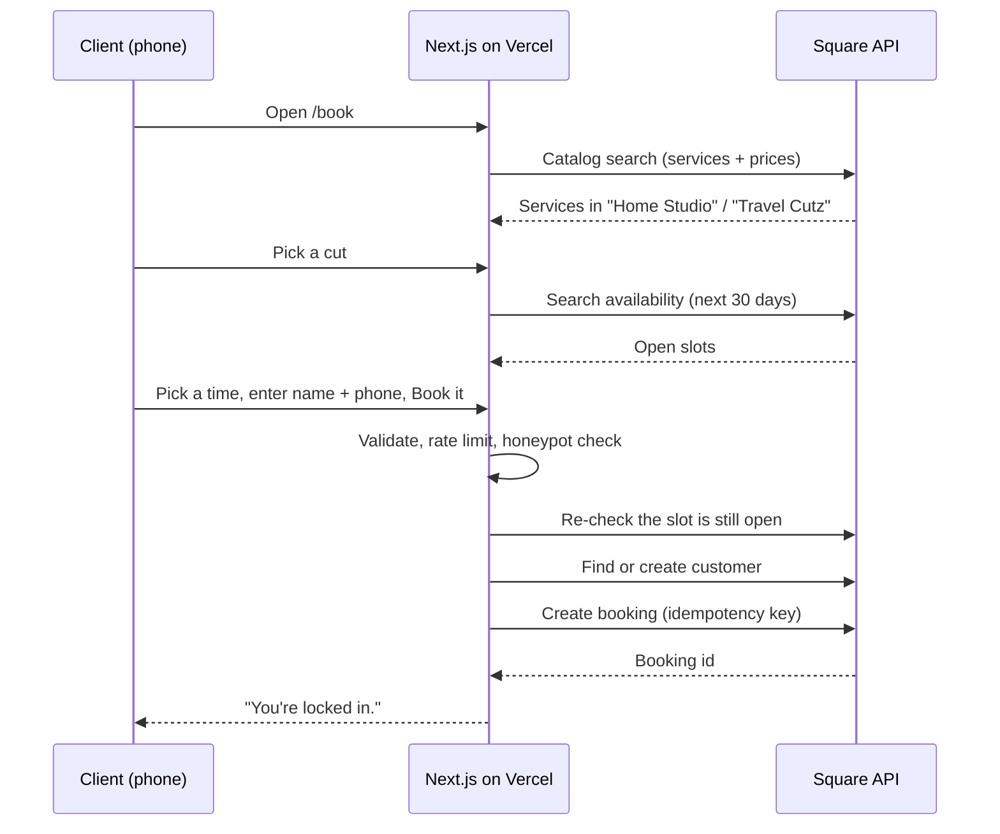
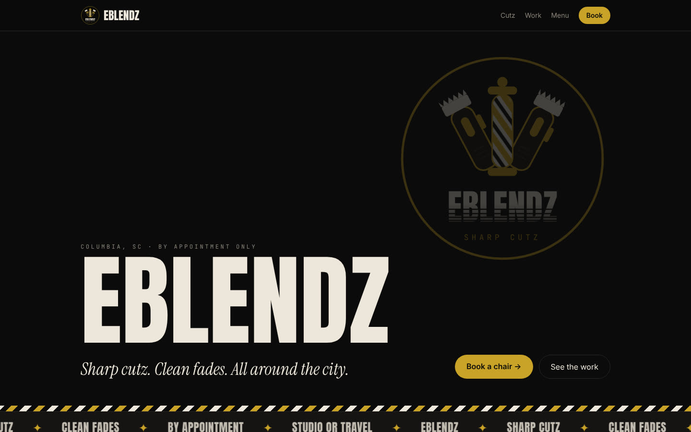

# Eblendz Booking

**Live:** [eblendzcutz.com](https://www.eblendzcutz.com)

A booking website for a local college barber in Columbia, SC. Clients see his real services and prices, pick an open time, and book in under a minute. Every booking lands straight in his Square calendar. No more booking through DMs.



## Why I built this

My friend cuts hair while going to school and working another job, and he was booking every appointment through Instagram DMs and texts. Clients asked the same price questions over and over, messages got missed, and slots got double-booked. I interviewed him, wrote requirements, designed the system in UML, and built a site that books straight into the Square account he already uses.

It's live, and real clients book through it.

## Features

- [x] Live services, prices and lengths pulled from Square (change a price in Square, the site updates within 5 minutes)
- [x] Two ways to book: **at the studio** or a **travel cut** where he comes to you (address required)
- [x] Pick a day and see only his real open times, up to 30 days out
- [x] Books directly into his Square Appointments calendar and creates or reuses the customer
- [x] Handles a slot getting taken mid-booking (keeps what you typed and reloads the times)
- [x] Never double-books on a retry (idempotency keys)
- [x] Falls back to "text to book" if Square is down, instead of crashing
- [x] Spam protection on the booking form (honeypot + per-IP rate limit)
- [x] Gallery, menu, and a link preview with his logo when the site is shared

## How it works



The browser never talks to Square and never sees a key. Every Square call happens in server-side API routes (`src/app/api`), and the server re-checks the price, length and time slot instead of trusting what the browser sends.

## Engineering decisions

| Decision | Why |
| --- | --- |
| **Square OAuth with buyer-level scopes** instead of a paid plan | The barber stays on Square's free plan. A one-time connect stores a refresh token, and the server swaps it for short-lived access tokens, cached until just before they expire. |
| **Square is the single source of truth** | He already manages his calendar, prices and hours in the Square app. The site has no database to keep in sync. |
| **Service classes over raw API calls** (`CatalogService`, `AvailabilityService`, `BookingService`, `CustomerService`) | Each Square concern lives in one place behind a shared base class with one configured client (Singleton). Matches the class diagram from my design docs. |
| **Same validation on client and server** (`src/lib/booking.ts`) | Instant feedback in the form, and the server still enforces the real rules. |
| **Idempotency key per booking attempt** | If a client double-taps or retries after a network error, Square creates only one booking. |
| **Times shown in the barber's time zone** | Someone visiting from another state still sees his local times. |
| **Business info in one config file** (`src/lib/siteConfig.ts`) | Phone, Instagram, service area and "every cut includes" can change without touching components. |

## Performance

Google Lighthouse (mobile): **Performance 92 · Accessibility 100 · Best Practices 100 · SEO 100**, with zero layout shift. Images are served through `next/image` at the size each screen needs, and the homepage is cached and refreshed from Square every 5 minutes.



## Tech stack

- **Next.js 16** (App Router, server components, API routes) + **React 19**
- **TypeScript**
- **Tailwind CSS v4**
- **Square APIs**: Catalog, Bookings, Customers, OAuth
- **Vercel** for hosting, with a custom domain

## Project structure

```
src/
  app/
    page.tsx              Homepage (hero, gallery, menu, booking CTA)
    book/page.tsx         Booking page
    api/
      services/           GET services from Square
      availability/       GET open times for a service
      bookings/           POST a booking (validation, rate limit, honeypot)
      oauth/              One-time Square connect
  components/             UI pieces (BookingFlow, Gallery, Menu, ...)
  lib/
    square.ts             Square client + token refresh
    square-services/      Catalog, Availability, Booking, Customer services
    booking.ts            Shared validation + booking window
    siteConfig.ts         The barber's info in one place
    time.ts               Time zone formatting
docs/                     Requirements + screenshots
```

## Design docs

Planned before coding, like a real software project:

- [Requirements document](docs/BarberRequirements.docx)
- [Functional & non-functional requirements](docs/barber-site-requirements.xlsx)
- UML: use case, class, and sequence diagrams

## Run it locally

```bash
npm install
cp .env.example .env.local   # then fill in your Square sandbox keys
npm run dev
```

Then open http://localhost:3000. Without Square keys, the homepage shows sample prices so you can still see the design.

To connect a Square account once: set `SQUARE_OAUTH_SETUP=true`, open `/api/oauth/start`, approve, copy the printed `SQUARE_REFRESH_TOKEN` into `.env.local`, then set `SQUARE_OAUTH_SETUP=false`.

## What I learned

- Designing from real requirements: interviewing a real user and turning his pain points into features.
- OAuth end to end: authorization codes, refresh tokens, scopes, and CSRF protection with a `state` cookie.
- Building around an external API: idempotency, re-checking state before writing, and what to do when it's down.
- Server vs. client in Next.js: keeping secrets and business rules on the server.
- Shipping: environment variables, deploys, a custom domain and DNS, and handing it off to a non-technical owner.
